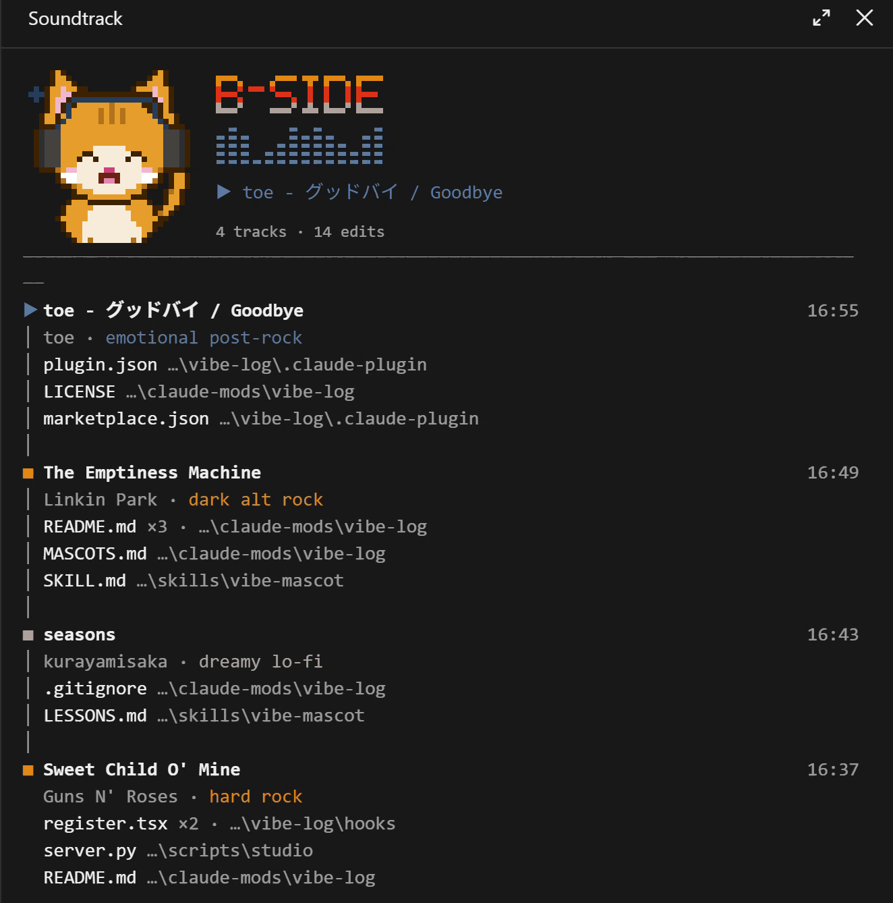

# pixel-mascot

A Claude Code skill that makes animated pixel-art sprites as one SVG file:
any character, animal, creature or object, with the animation states you
name (idle, happy, sleep, walk…; one idle loop if you name none).

Claude draws the sprite from a small Python builder script, so every tweak is
a re-run, not a hand edit. You review it in a local studio that shows every
state animating side by side, and fix pixels yourself in its editor. It uses
only the Python standard library, so there is nothing to install beyond
Python 3. It runs on Windows, macOS and Linux.



*A mascot made with this kit, in use: Miso dancing in the pane of
[B-side](https://github.com/cheeseburgerhere/b-side), a separate Claude Code
mod that logs the music you code to. The pane, the equalizer and the moods
come from B-side, not from this repo.*

## Install

At the prompt of a Claude Code terminal session:

```
/plugin install pixel-mascot --marketplace cheeseburgerhere/pixel-mascot
```

Answer `y` to add the marketplace, then pick a scope (user is the usual one).
From a shell:

```
claude plugin install pixel-mascot --marketplace cheeseburgerhere/pixel-mascot
```

In the desktop app, where `/plugin` does not run: click + next to the prompt
box, then Plugins, Add marketplace with `cheeseburgerhere/pixel-mascot`, then
Add plugin.

## Use

Ask Claude, for example "make me a pixel mascot of a sleepy fox with idle and
sleep states", or start the skill yourself with `/pixel-mascot:pixel-mascot`.
Claude then:

1. asks what makes your mascot recognizable and keeps to those 3-5 features,
   and asks which states it needs;
2. asks where to keep it (default `~/pixel-mascots/<name>/`) and writes a
   builder, `make_<name>.py`, that draws it as 32×32 (or 20×20) pixel art;
3. renders a PNG preview of every state and shows it to you;
4. opens the **studio**, a local page at `http://127.0.0.1:8765/` where every
   state animates side by side, with a pixel editor (`/editor.html`) whose
   edits survive every rebuild.

The result is one SVG. It plays its default state on its own (in a browser,
an ``, a README); an app shows another state by setting the root's
class, `<svg class="sleep">`.

## Try the example by hand

Miso the cat, with idle, happy and sleep states, is the template every new
mascot starts from. From this folder (on Windows, use `python` and set
`$env:PYTHONPATH = "skills/pixel-mascot/scripts"` instead):

```bash
PYTHONPATH=skills/pixel-mascot/scripts python3 skills/pixel-mascot/scripts/example_mascot.py miso.svg
python3 skills/pixel-mascot/scripts/preview.py miso.svg sheet.png
python3 skills/pixel-mascot/scripts/studio/server.py --svg miso.svg --build skills/pixel-mascot/scripts/example_mascot.py
```

Then open `http://127.0.0.1:8765/`.

## What's inside

- [`skills/pixel-mascot/SKILL.md`](skills/pixel-mascot/SKILL.md): the workflow and the rules the SVG follows.
- [`skills/pixel-mascot/LESSONS.md`](skills/pixel-mascot/LESSONS.md): what went wrong in earlier mascots, and the fixes.
- `skills/pixel-mascot/scripts/`: the kit (`pixelkit.py`), the preview (`preview.py`), hand-edit support (`pixel_overrides.py`), the studio (`studio/`) and the example (`example_mascot.py`).

Only use art you made or may share: never copy another artist's pixels or
publish a copyrighted character.

## Used by B-side

[B-side](https://github.com/cheeseburgerhere/b-side) ships a copy of this kit
for its dancing pane mascot. This repo is the source of truth: change the kit
here, then refresh B-side's copy from a B-side checkout with
`python tools/sync_kit.py <path to this repo>` (see B-side's README).

## License

MIT, see [LICENSE](LICENSE).
